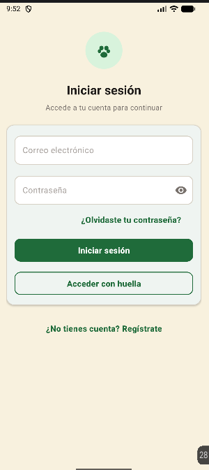
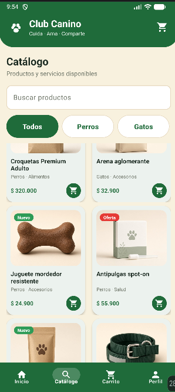
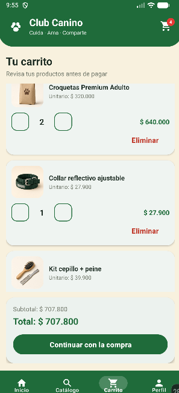
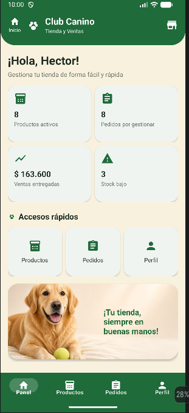
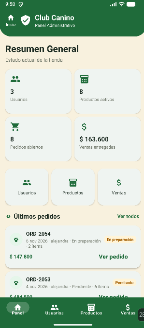

# Club Canino 🐾

Aplicación móvil **nativa para Android** de una tienda virtual de productos para mascotas. Tiene tres roles (**Comprador**, **Vendedor** y **Administrador**), cada uno con su propia navegación y pantallas.

Los usuarios, el catálogo, el carrito y los pedidos se guardan en **Firebase** (Authentication, Cloud Firestore y Storage). El pago con tarjeta se consulta en un backend **Node.js** publicado en Render. La aplicación no guarda llaves de ePayco ni la cuenta de servicio.

## Funcionalidades

**Autenticación**
- Pantalla de bienvenida, inicio de sesión, registro y recuperación de contraseña por correo de Firebase.
- El registro público crea siempre una cuenta con rol **Comprador**. Las cuentas de Vendedor y de Administrador se crean desde el panel del administrador.
- Validación de formularios (correo, campos obligatorios y contraseña de al menos 6 caracteres).
- Inicio de sesión con **huella** (AndroidX Biometric) después del primer ingreso con correo y contraseña.
- Cada usuario entra solo al panel de su rol.

**Comprador**
- Inicio con promociones y catálogo por categorías (perros, gatos, alimentos, accesorios, salud, promociones).
- Detalle de producto, carrito y dirección de entrega.
- Métodos de pago: **Efectivo contra entrega**, **Transferencia simulada** y **Tarjeta de demostración**.
- Efectivo y transferencia registran el pedido con el pago pendiente. La tarjeta consulta el backend. Mientras el servidor no tenga las llaves de prueba de ePayco, ese pedido también queda pendiente y no se marca como pagado.
- Perfil con las mascotas de la cuenta y el historial de pedidos.

**Vendedor**
- Panel con resumen de la tienda, incluido el nivel de stock.
- Gestión de productos (crear, editar, eliminar), con fotografía de la cámara o de la galería.
- Gestión de pedidos con estados: *Pendiente → En preparación → En camino → Entregado* (o *Cancelado*).
- Perfil de la tienda.

**Administrador**
- Panel con estadísticas generales.
- Gestión de usuarios y roles.
- Gestión de productos y reporte de ventas.
- Este rol no tiene carrito.

## Tecnologías

- **Kotlin** y pantallas en **XML**
- Android SDK: minSdk 24, compileSdk y targetSdk 37
- AndroidX: AppCompat, Activity KTX, ConstraintLayout, Biometric
- **Material Design Components**
- Google Play Services Location
- **Firebase**: Authentication, Cloud Firestore y Cloud Storage (BOM 33.16.0)
- Backend Node.js (Express y Firebase Admin), publicado en Render
- Gradle 9.6.0 (Kotlin DSL) y Android Gradle Plugin 9.5.0, con catálogo de versiones (`gradle/libs.versions.toml`)

## Estructura

```
app/src/main/java/com/clubcanino/app/
├── auth/         # bienvenida, login, registro, recuperación y biometría
├── buyer/        # catálogo, carrito, pago, perfil y mascotas del comprador
├── seller/       # productos, pedidos y perfil del vendedor
├── admin/        # panel, usuarios, productos y ventas
├── navigation/   # navegación por rol
└── common/       # roles y componentes compartidos
backend/          # servidor de pagos y de cuentas de administrador
firestore.rules   # reglas de Cloud Firestore
storage.rules     # reglas de Cloud Storage
```

## Cómo ejecutarlo

1. Clonar el repositorio:
   ```bash
   git clone https://github.com/DianaManci/ClubCanino.git
   ```
2. Abrirlo en **Android Studio** (versión reciente, compatible con Android Gradle Plugin 9.5.0).
3. Colocar `google-services.json` dentro de la carpeta `app/`.

   Ese archivo conecta la aplicación con el proyecto de Firebase `club-canino`. Está en `.gitignore`, así que un clon nuevo no lo trae. La entrega del código fuente sí lo incluye. Si falta, descárgalo desde la consola de Firebase del proyecto `club-canino` y déjalo en `app/google-services.json`. No pegues su contenido en el código ni en este archivo.
4. Crear `backend.properties` en la raíz del proyecto, a partir de `backend.properties.example`:
   ```properties
   BACKEND_BASE_URL=https://clubcanino.onrender.com
   ```
   Esa URL es la del backend ya publicado. El archivo `backend.properties` tampoco se sube a Git. Si se omite, la aplicación compila con la dirección vacía y el pago con tarjeta no puede consultar el servidor.
5. Esperar la sincronización de Gradle. El wrapper descarga Gradle 9.6.0.
6. Ejecutar en un emulador o en un celular con Android 7.0 (API 24) o superior, con conexión a internet.

Las cuentas se crean desde la aplicación: **Registrarme** abre una cuenta de Comprador. Para probar Vendedor o Administrador hace falta una cuenta que ya tenga ese rol en Firestore.

Las llaves de ePayco y el archivo `service-account.json` viven solo en el servidor. No hacen falta para abrir ni ejecutar la aplicación, y no deben copiarse a este proyecto.

## Pruebas locales

Desde la raíz del proyecto, en Windows:

```bat
gradlew.bat :app:testDebugUnitTest
```

En `backend/`, después de `npm install`:

```bat
npm test
```

Esas pruebas no usan las llaves reales ni modifican los usuarios de Firebase.

## Capturas

| Inicio de sesión | Catálogo | Carrito | Panel del vendedor | Panel del administrador |
|---|---|---|---|---|
|  |  |  |  |  |

## Autora

**Diana Alejandra Mancipe Jiménez** · [LinkedIn](https://www.linkedin.com/in/diana-alejandra-mancipe-jimenez-737669334/) · mancipealejandra63@gmail.com
