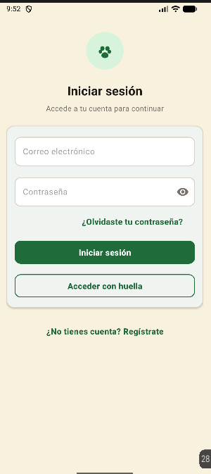
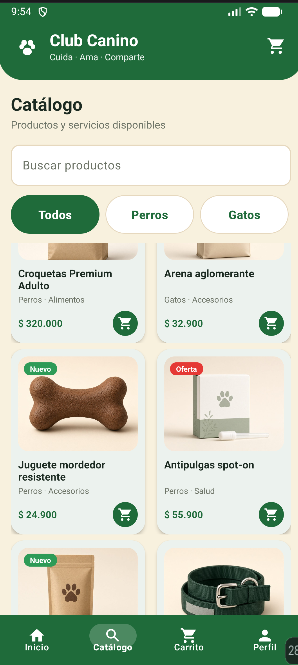
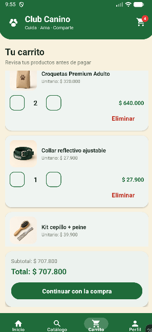
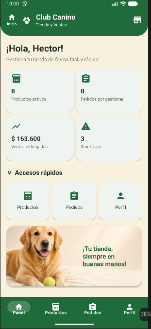
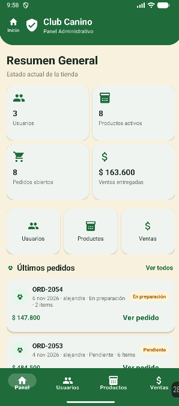

# Club Canino 🐾

Aplicación móvil **nativa para Android** de una tienda virtual de productos para mascotas. Tiene tres roles (**comprador**, **vendedor** y **administrador**), cada uno con su propia navegación y pantallas.

## Funcionalidades

**Autenticación**
- Pantalla de bienvenida (splash), inicio de sesión, registro y recuperación de contraseña.
- Validación de formularios (correo, campos obligatorios, longitud de contraseña).
- Contraseñas guardadas como hash SHA-256 con sal aleatoria; la contraseña nunca se guarda en texto plano.
- Inicio de sesión con **huella o rostro** (AndroidX Biometric).
- Cada usuario entra solo al panel de su rol.

**Comprador**
- Inicio con promociones y catálogo por categorías (perros, gatos, alimentos, accesorios, salud, promociones).
- Detalle de producto, carrito de compras y pago simulado con confirmación del pedido.
- Perfil con registro de sus mascotas.

**Vendedor**
- Panel con resumen de la tienda.
- Gestión de productos (crear, editar, eliminar).
- Gestión de pedidos con estados: *Pendiente → En preparación → En camino → Entregado* (o *Cancelado*).
- Perfil de la tienda.

**Administrador**
- Panel con estadísticas generales.
- Gestión de usuarios y roles.
- Gestión de productos y reporte de ventas.

## Tecnologías

- **Kotlin** · Android SDK (minSdk 24)
- AndroidX: AppCompat, Activity KTX, ConstraintLayout, Biometric
- **Material Design Components**
- Persistencia local con SharedPreferences
- Gradle (Kotlin DSL) con catálogo de versiones (`libs.versions.toml`)

## Estructura

```
app/src/main/java/com/clubcanino/app/
├── auth/         # splash, login, registro, recuperación, biometría, hash de contraseñas
├── buyer/        # catálogo, carrito, pago, perfil y mascotas del comprador
├── seller/       # productos, pedidos y perfil del vendedor
├── admin/        # panel, usuarios, productos y ventas
├── navigation/   # selección de rol y navegación por rol
└── common/       # roles y componentes compartidos
```

## Cómo ejecutarlo

1. Clonar el repositorio:
   ```bash
   git clone https://github.com/DianaManci/ClubCanino.git
   ```
2. Abrirlo en **Android Studio** (versión reciente, compatible con el Android Gradle Plugin del proyecto).
3. Esperar la sincronización de Gradle.
4. Ejecutar en un emulador o celular con Android 7.0 (API 24) o superior.

Cuentas de demostración: la app crea usuarios de prueba (dominio `@clubcanino.demo`) con la contraseña inicial definida en `ShopUserStore.kt`.

## Capturas

| Inicio de sesión | Catálogo | Carrito | Panel del vendedor | Panel del administrador |
|---|---|---|---|---|
|  |  |  |  |  |

> Pendiente: publicar un APK en *Releases*.

## Autora

**Diana Alejandra Mancipe Jiménez** · [LinkedIn](https://www.linkedin.com/in/diana-alejandra-mancipe-jimenez-737669334/) · mancipealejandra63@gmail.com

---

